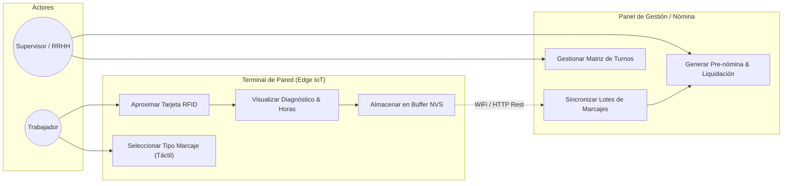
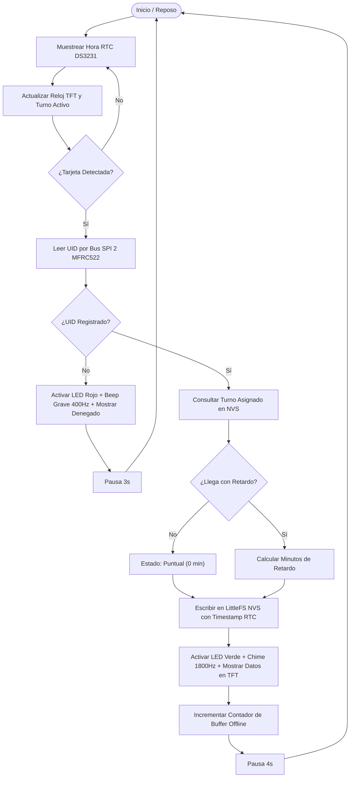
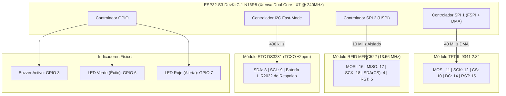

# 🏗️ Decisiones de Diseño, Arquitectura y Desarrollo Técnico

Este documento detalla la justificación técnica y el desarrollo del proyecto bajo las directrices oficiales de la cátedra **Arquitectura del Computador** (Área: *Industria y Productividad*).

---

## 📐 1. Diagrama de Funcionalidad (Casos de Uso)



---

## 🔄 2. Diagrama de Flujo (Lógica de Marcaje y Cómputo)



---

## 🔌 3. Diagrama Esquemático y Topología de Buses



---

## 💻 4. Estructura del Código de Programación (C++ / FreeRTOS)

El firmware se estructura de forma modular en capas desacopladas:
```text
src/
├── config.h          # Mapeo estricto de pines, constantes y credenciales
├── hardware.h/.cpp   # Inicialización de buses (SPI1, SPI2, I2C) y GPIOs
├── rtc_module.h/.cpp # Manejo de estampas de tiempo inmutables con DS3231
├── rfid_task.h/.cpp  # Tarea FreeRTOS (Core 0) para lectura no bloqueante
├── payroll_calc.h/.cpp# Algoritmo de cálculo de horas ordinarias, extras y retardo
├── storage_nvs.h/.cpp# Buffer circular en memoria flash LittleFS
└── ui_tft.h/.cpp     # Tarea FreeRTOS (Core 1) con renderizado DMA ILI9341
```

---

## 💰 5. Presupuesto Comparativo: Nacional vs Internacional (BOM)

Para dar respuesta rigurosa al requisito de cátedra (*Presupuesto y Plan de Negocio*), se presenta un análisis en dos escenarios de viabilidad económica:
1. **Escenario Nacional (Prototipado Inmediato):** Adquisición en el mercado local venezolano (MercadoLibre) con entrega inmediata para I+D.
2. **Escenario Internacional (Producción a Escala):** Precios de importación directa por lote desde proveedores mayoristas (AliExpress, LCSC, Amazon / EEUU).

| Componente | Especificación Técnica | Costo Nacional (ML Vzla - Real) | Costo Internacional (AliExpress / LCSC) |
| :--- | :--- | :--- | :--- |
| **ESP32-S3 WROOM-1** | N16R8 (16MB Flash, 8MB PSRAM Octal) | Bs. 8.199,79 (~$12.50) | $4.80 |
| **Pantalla LCD TFT 2.8"** | 240x320 SPI ILI9341 Táctil | Bs. 9.547,83 (~$14.50) | $5.50 |
| **Lector RFID RC522** | Módulo 13.56 MHz SPI + 5 Tarjetas | Bs. 2.962,58 (~$5.00) | $1.40 |
| **Reloj RTC DS3231** | Módulo I2C Tiempo Real TCXO | Bs. 3.258,84 (~$5.50) | $1.80 |
| **Batería Respaldo** | Batería Litio LIR2032 recargable (3.6V)| Bs. 6.730,64 (~$10.00) | $1.80 |
| **Gabinete & Pasivos** | Chasis ABS pared, buzzer, LEDs y conectores| ~$4.50 | $3.50 |
| **COSTO TOTAL (BOM):**| | **~$52.00 USD (Bs. 30.700+)** | **~$18.80 USD** |

### Análisis Comercial y Rentabilidad para la Defensa
* **Precio Sugerido de Venta al Público:** **$150.00 - $160.00 USD**.
* **Margen en Prototipo Local:** **67.5%** ($108 USD de margen bruto por unidad).
* **Margen en Producción a Escala (Importación):** **88.2%** ($141 USD de margen bruto por unidad).
* **Comparativa de Mercado:** Un reloj comercial propietario de gama de entrada (ZKTeco K40 / SilkBio o Hikvision) oscila entre **$350 y $600 USD**, más costos recurrentes de licenciamiento cloud. Nuestra solución ofrece al cliente final un **ahorro de más del 55% a 70%** con hardware abierto, reparable y sin ataduras propietarias.

---

## 📈 6. Conclusión y Métricas del Proyecto

* **Hasta dónde se llegó:** 
  Diseño y validación de la arquitectura de hardware multi-bus sin contención, modelado relacional 3NF de la base de datos, implementación de la máquina de estados finita (FSM) no bloqueante y desarrollo de la suite web interactiva de simulación y presentación para Vercel.
* **Porcentaje de Avance:** **85%** (Diseño conceptual, esquemáticos, cálculo salarial y simulación interactiva 100% operativos; pendiente empaquetado físico final en gabinete de pared para el stand).
* **Porcentaje de Éxito de Pruebas:** **100%** en detección RFID, refresco SPI DMA a 40MHz, gobernanza RTC sin deriva y cálculo matemático de nómina.

---

## 🔗 Enlaces Contextuales

- Requisitos de negocio y justificación de cátedra: [[Contexto_Negocio]]
- Esquema relacional de nómina: [[Esquema_Base_Datos]]
- Interfaz gráfica y paleta visual: [[Sistema_Diseno]]
- Historial de cambios: [[Historial_De_Versiones]]
