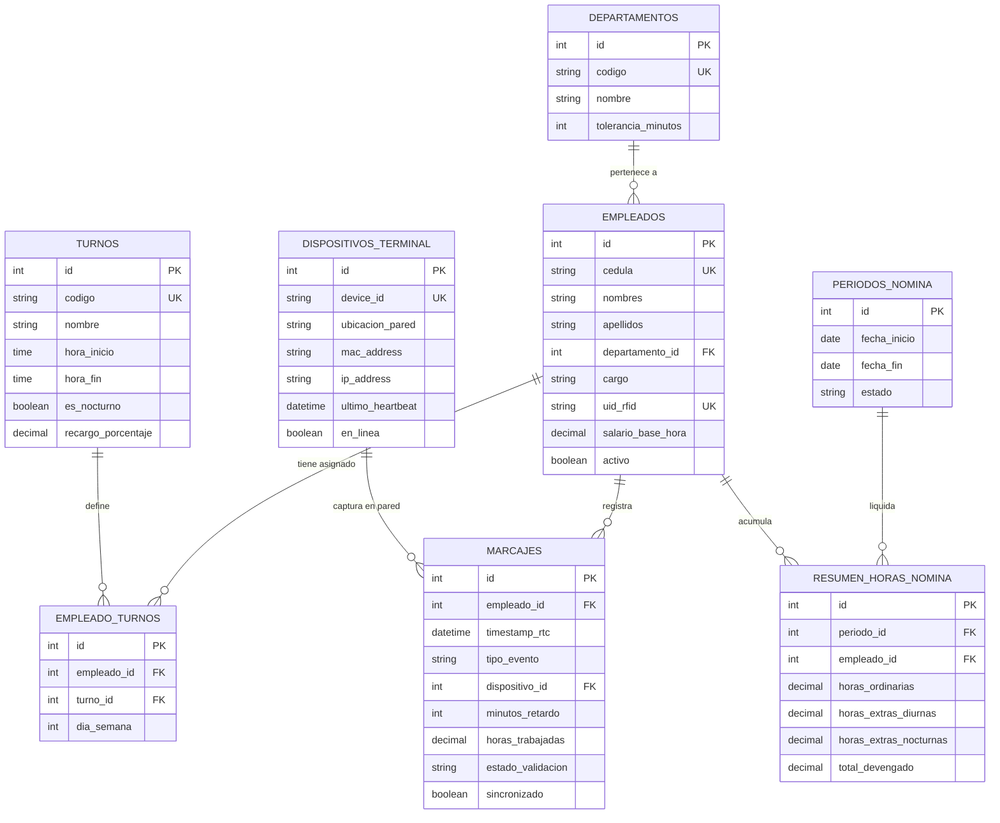

# 🗄️ Esquema de Base de Datos y Modelo Relacional (3NF)

Este documento define la arquitectura de datos del sistema **ChronoLink™ Enterprise**, garantizando la **Tercera Forma Normal (3NF)** para evitar anomalías de inserción, actualización y borrado, optimizando la persistencia tanto en el Edge (SQLite / LittleFS local en NVS) como en la API centralizada.

---

## 📐 Diagrama Entidad-Relación (ERD)

---

## 🛡️ Principios de Integridad y Normalización

1. **Cumplimiento Estricto de 3NF:**
   - **1NF:** Todos los atributos son atómicos; no existen campos repetitivos ni listas serializadas en una sola celda.
   - **2NF:** Se eliminan dependencias parciales; las claves foráneas en tablas intermedias como `EMPLEADO_TURNOS` dependen de la clave primaria completa.
   - **3NF:** No existen dependencias transitivas; los datos del departamento o del turno no se duplican dentro de la tabla `MARCAJES`.
2. **Inmutabilidad de Marcajes:** 
   La tabla `MARCAJES` opera como un libro de auditoría forense (*append-only*). Las filas no deben modificarse; correcciones administrativas se registran mediante marcajes de rectificación explícitos.
3. **Resiliencia Local (Edge-Storage en ESP32-S3):**
   El ESP32-S3 almacena una tabla local indexada en NVS Flash/LittleFS con hasta 10,000 transacciones con la bandera `sincronizado = false` para garantizar cero pérdida de marcajes ante fallos de conectividad.

---

## 🔗 Enlaces Contextuales

- Especificación de negocio y roles: [[Contexto_Negocio]]
- Asignación de buses y arquitectura física: [[Decisiones_Diseno]]
- Interfaz gráfica y estados visuales: [[Sistema_Diseno]]
- Control de versiones: [[Historial_De_Versiones]]
